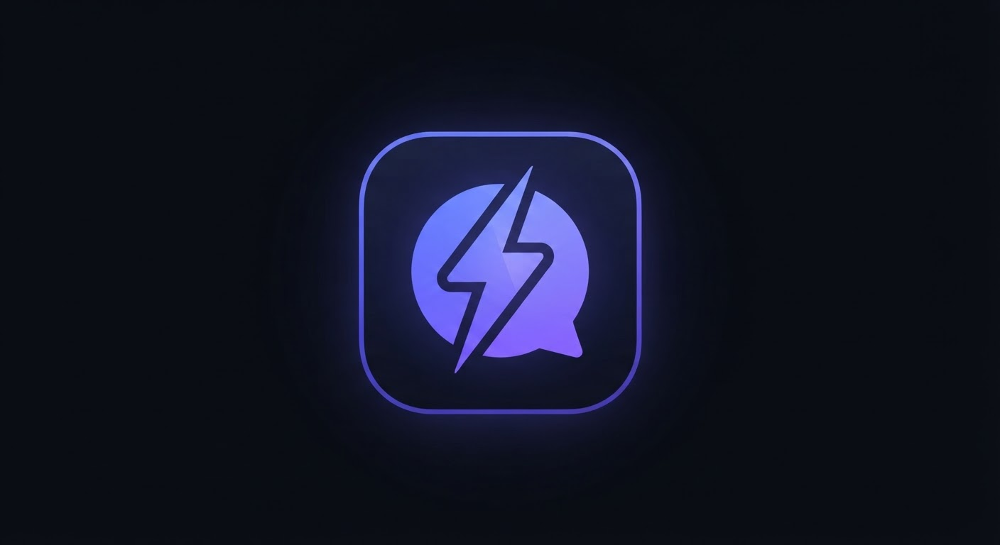

<p align="center">
  
</p>

<h1 align="center">⚡ Kilat AI</h1>

<p align="center">
  <b>Asisten AI lokal yang cepat, privat, dan gratis — berjalan 100% di komputer Anda.</b><br>
  Chat streaming · Mode agen (buat/baca file) · Mode Arena multi-model · Input suara · Embed widget · Docker
</p>

<p align="center">
  
  
  
  
</p>

---

## ✨ Fitur

| Fitur | Keterangan |
|---|---|
| 💬 **Chat streaming** | Markdown, blok kode + tombol salin, riwayat obrolan |
| 🔧 **Mode agen** | AI bisa membuat, membaca, dan melihat file di folder `workspace/` |
| 🏟️ **Mode Arena** | Satu pertanyaan dijawab 2–4 model sekaligus → model juri memilih jawaban terbaik; model berjalan bergantian dengan unload otomatis agar hemat RAM |
| 🏢 **Integrasi aplikasi internal** | Plugin `plugins/*.py` memberi AI akses data/fungsi aplikasi Anda (contoh: treasury) + `PENGETAHUAN.md` sebagai konteks |
| 📝 **Laporan & entry data** | Bikin laporan via chat (Markdown/HTML, viewer render), catat data dengan pola aman maker-checker |
| 🎤 **Suara** | Input mic (opsional 100% offline via whisper.cpp) + text-to-speech |
| 📤 **Upload file** | Tarik & lepas ke workspace agar bisa dibaca AI |
| ☁️ **Mode Cloud (opsional)** | API Anthropic (Claude) / OpenRouter / OpenAI / Groq / LM Studio lokal |
| 🔗 **Embed widget** | Satu baris `<script>` untuk memasang chat melayang di website mana pun |
| 🌗 **Tema terang/gelap** | — |
| 🐳 **Docker** | `docker compose up` → langsung jalan |

## 🚀 Mulai cepat

**Prasyarat:** Python 3.8+, [Ollama](https://ollama.com), RAM 8 GB+ (model 16 GB+ disarankan)

```bash
# 1. Ambil model (contoh untuk RAM 16 GB)
ollama pull qwen3:8b

# 2. Jalankan aplikasi
python app.py          # atau dobel-klik Mulai-Kilat.bat di Windows

# 3. Buka browser
#    http://localhost:8080
```

**Atau dengan Docker** (Ollama ikut dalam container):

```bash
docker compose up -d --build
docker compose exec ollama ollama pull qwen3:8b
```

**Coba tanpa model?** Mode demo: `python mock-ollama.py` + `python app.py` → pilih model `demo-*`.

## 🏟️ Contoh Mode Arena (3 LLM gratis sekaligus)

```bash
ollama pull qwen3:8b && ollama pull gemma3:12b && ollama pull deepseek-r1:8b
```
Aktifkan 🏟️ Arena di aplikasi → centang ketiganya → setiap pertanyaan dijawab bergantian, juri memilih yang terbaik. RAM hanya perlu sebesar model terbesar (model lain otomatis di-unload).

## 🏢 Integrasi aplikasi internal (studi kasus treasury)

- `PENGETAHUAN.md` — deskripsi fitur/istilah/SOP aplikasi Anda, otomatis jadi pengetahuan AI
- `plugins/contoh-treasury.py` — contoh tool `treasury_saldo` / `treasury_kurs` / `treasury_transaksi` / `treasury_catat_pengajuan` (ganti isinya dengan panggilan API/DB aplikasi Anda, **read-only**)
- Prinsip aman: AI hanya *maker* (mencatat), manusia *checker* (menyetujui)

## 📚 Dokumentasi

Semua panduan lengkap ada di **[PANDUAN.md](PANDUAN.md)** — instalasi pemula, kebutuhan hardware, rekomendasi model, Mode Arena, embed di website, mode offline total, Docker, sampai troubleshooting.

## 🔒 Privasi

Tanpa Mode Cloud, semua percakapan hanya mengalir **browser → app.py → Ollama** di komputer Anda sendiri. Tidak ada telemetri, tidak ada data keluar.

## ⚠️ Catatan

- Proyek independen yang terinspirasi produk AI modern — tidak berafiliasi dengan arena.ai maupun penyedia model lain
- Jawaban AI bisa keliru — verifikasi selalu angka/keputusan penting
- Model besar (kelas frontier) butuh hardware memadai — lihat tabel hardware di PANDUAN.md
